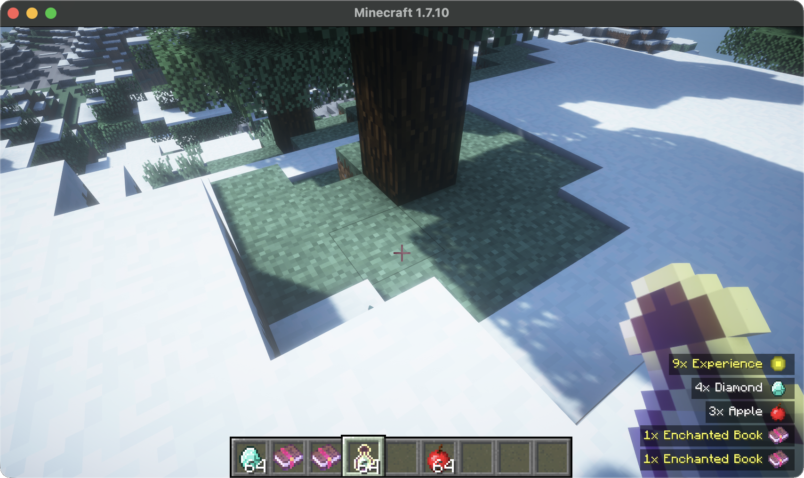

# Vintage Pick Up Notifier

`1.7.10 Forge` [Pick Up Notifier](https://github.com/Fuzss/pick-up-notifier) backport.


[](https://github.com/AngelicIndustries/VintagePickUpNotifier/releases)
[](https://www.curseforge.com/minecraft/mc-mods/vintage-pick-up-notifier)
[](https://modrinth.com/mod/vpun)
[](https://67minecraft.com/mod/vpun)
[](https://maven.angelic.industries/#/releases/industries/angelic/vintagepickupnotifier/VintagePickUpNotifier)

[](https://discord.gg/xAWCqGrguG)



## Features

* Feature parity with the original mod, as of version `v26.1.1`
* Fixed XP value vs orb amount toggle
* Customizable gap size between notifications

## Dependencies
* [UniMixins](https://modrinth.com/mod/unimixins) [](https://www.curseforge.com/minecraft/mc-mods/unimixins)  [](https://modrinth.com/mod/unimixins/versions) [](https://github.com/LegacyModdingMC/UniMixins/releases)

UniMixins 0.1.23 or newer is required. AngelLib is not required.

## Compatibility

This mod is compatible with the following mods:
* OKBackpack [](https://www.curseforge.com/minecraft/mc-mods/okbackpack)  <!--[](https://modrinth.com/mod/unimixins/versions)--> [](https://github.com/Shigure-Ruiseki/OKBackpack)

## Building

```sh
./gradlew build
```

Development runs include AngelLib and other QoL/compatibility mods. These are not required by the published mod.

Maven coordinates: `industries.angelic.vintagepickupnotifier:VintagePickUpNotifier:1.0.0` from [Angelic Maven](https://maven.angelic.industries/releases).

## Credits

* Maintained by [Angelic Industries](https://angelic.industries/)
* [Pick Up Notifier](https://github.com/Fuzss/pick-up-notifier) by Fuzss
* [GT:NH buildscript](https://github.com/GTNewHorizons/ExampleMod1.7.10)

## License

`LGPLv3`.

* [Pick Up Notifier code is licensed under Mozilla Public License Version 2.0](https://github.com/Fuzss/pick-up-notifier/blob/main/LICENSE.md).

## Buy me some creatine

* [ko-fi.com](https://ko-fi.com/jackisasubtlejoke)
* Monero: `893tQ56jWt7czBsqAGPq8J5BDnYVCg2tvKpvwTcMY1LS79iDabopdxoUzNLEZtRTH4ewAcKLJ4DM4V41fvrJGHgeKArxwmJ`

<br>


